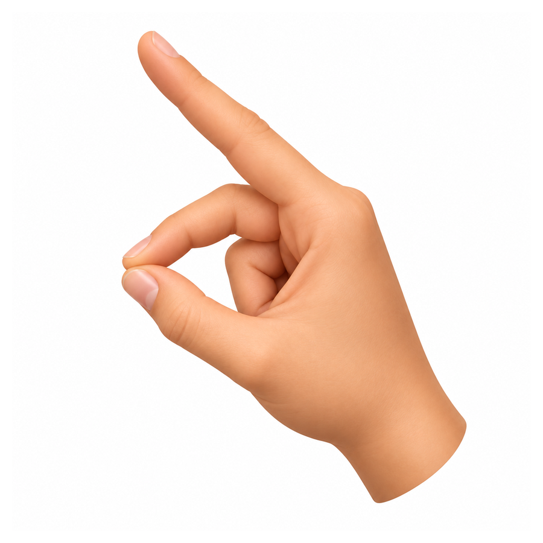
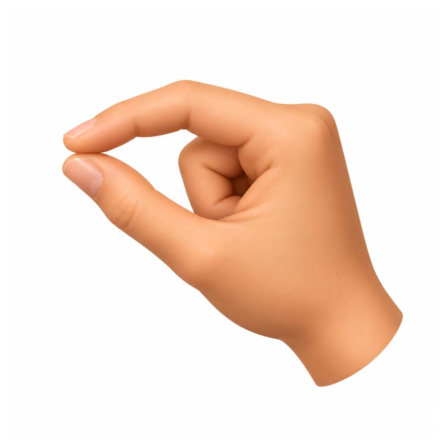
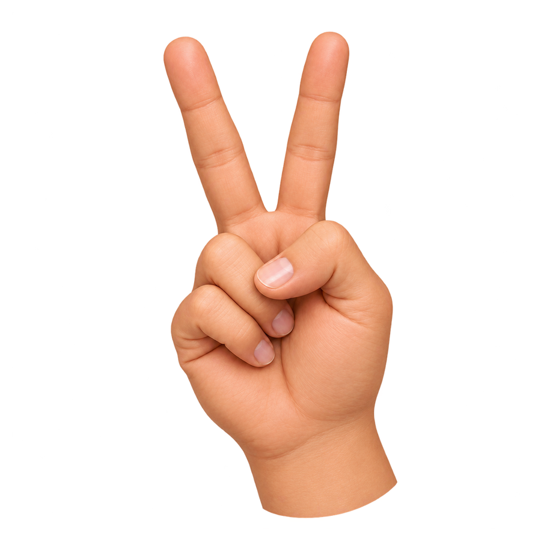

<div align="center">

# AI Virtual Mouse 🖱️🤖

**Control your computer with hand gestures — no physical mouse required.**

A computer-vision-based virtual mouse built with **Python, OpenCV, MediaPipe, and PyAutoGUI**.

</div>

---

## ✨ Features

- **Touchless cursor control** using your webcam.
- **Gesture-based clicking** for left and right mouse clicks.
- **Hand-gesture scrolling** to navigate pages.
- **Smooth cursor movement** to help reduce jitter.
- **Configurable tracking area and sensitivity** for a more comfortable experience.

## 🖐️ Gesture Control Guide

Show your hand to the webcam and perform the gestures below. The exact gesture thresholds and visual feedback depend on the implementation in `hand_tracking.py`.

| Action | Gesture | How to use it |
|:--|:--:|:--|
| **Move Cursor** |  | Extend your index finger and move your hand to guide the cursor. |
| **Left Click** |  | Bring your thumb and index fingertip together. |
| **Right Click** |  | Bring your index and middle fingertips together. |
| **Scroll Up / Down** |  | Pinch your middle finger and thumb, then move your hand up or down. |

> **Note:** The images are visual guides. Make sure the gestures and thresholds in this table match the current code in your project.

## 🧰 Tech Stack

- **Python** — application logic
- **OpenCV** — webcam and image processing
- **MediaPipe** — real-time hand landmark tracking
- **PyAutoGUI** — operating-system mouse control

## 🚀 Installation & Setup

### 1. Requirements

- Windows 10/11
- Python version compatible with the packages in `requirements.txt` (Python 3.12 is recommended only if your installed MediaPipe version supports it)
- A working webcam

### 2. Clone this repository

```bash
git clone https://github.com/Mira-Clouds/AI-Virtual-Mouse.git
cd AI-Virtual-Mouse
```

### 3. Create and activate a virtual environment

```powershell
python -m venv .venv
.\.venv\Scripts\Activate.ps1
```

If PowerShell blocks activation, you can use Command Prompt instead:

```bat
.venv\Scripts\activate.bat
```

### 4. Install dependencies

```bash
python -m pip install --upgrade pip
pip install -r requirements.txt
```

### 5. Start the application

```bash
python hand_tracking.py
```

If your main Python file has a different name or location, update the command to match your project structure.

## ⚙️ Customization

Open `hand_tracking.py` and look for the relevant settings. Names and default values may differ by implementation.

| Setting | Purpose |
|:--|:--|
| `smooth_factor` | Controls cursor smoothing. More smoothing can feel steadier but may add lag. |
| `click_dist` | Sets the distance threshold used to detect a pinch. |
| `margin_x` / `margin_y` | Adjusts the active webcam tracking area. |

## 📁 Project Structure

```text
AI-Virtual-Mouse/
├── assets/
│   ├── move.png
│   ├── left_click.png
│   ├── right_click.png
│   └── scroll.png
├── hand_tracking.py
├── webcam_test.py
├── requirements.txt
└── README.md
```

*The file tree above is an example. Keep only the files that actually exist in your repository.*

## 🔒 Privacy & Safety

- The application uses the webcam for hand tracking.
- Tell users when the camera is active and close the application when finished.
- Test gestures carefully before using them with important files or system controls.

## 🤝 Contributing

Contributions and suggestions are welcome. For significant changes, open an issue first to discuss the proposed improvement.

## 📜 License

This project can use the [MIT License](https://choosealicense.com/licenses/mit/) if an MIT `LICENSE` file is included in the repository.

---

<div align="center">

Made with ❤️ using Python and Computer Vision

</div>
